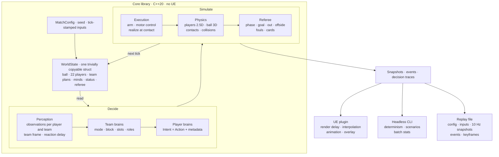

# OnzeEngine Specifications--Overview

Status: pre-alpha, 2026-11-09.

## 1. What we build

A football (soccer) match engine in two parts:

- **The core.** A standalone C++20 library simulates one 11 v 11 match. It has no Unreal Engine code. It runs headless.
- **The viewer.** An Unreal Engine 5 (UE) plugin shows the match. It only reads snapshots, events and decision traces from the core.

A headless command-line tool (CLI) and a replay file use the same core output.

## 2. Goals

1. Simulate 22 players and one ball. Players are 2.5D: they move continuously on the x/y plane and have a height state (stand, jump, dive, slide, fall). The ball is a 3D rigid sphere with physics.
2. Make decisions with a small, readable AI. You can inspect every decision in real time.
3. Let attributes, fatigue and context set how well a player executes an action.
4. Support offside, fouls, cards and basic set pieces.
5. Keep the core independent from UE, so that it runs headless and you can test it.
6. Keep clear extension points for perception noise, search-based planning and reinforcement learning (RL).
7. Give every attribute a clear, testable mechanism. No attribute dominates. Speed attributes can dominate a match engine. Public community tests of Football Manager show this: in FM-Arena's FM24 tests, raising Pace or Acceleration from 8 to 20 adds about 64 points over 38 matches, far more than any other attribute (https://fm-arena.com/thread/14009-attribute-testing-football-manager-24/).
8. Make A/B experiments on attributes and tactics cheap and statistically strong.

## 3. Non-goals (Not in MVP)

- Full set pieces (routines, rehearsed moves, complex wall and marking schemes).
- Season, transfer or club management.
- A user-facing explanation UI. The MVP has a developer debug overlay. The data model keeps everything that a later user-facing view needs.
- Cross-platform floating-point determinism.

## 4. Design principles

| # | Principle | Rules |
|---|---| ---|
| P1 | **One-way data flow** | The core has zero dependency on UE. It emits snapshots, events, and decision traces, and accepts commands strictly through a single tick-stamped input channel shared by UE and the CLI. |
| P2 | **Data-oriented state** | State is plain data; systems are stateless functions. `WorldState` is trivially copyable (structs, fixed arrays, and indices—no pointers, virtual functions, or heap allocations). |
| P3 | **Action-only output** | `Action` is the sole contract between brain and physics. Physics resolves mechanics from the `Action` and never inspects brain intent or metadata. |
| P4 | **Human-only noise** | The ball and body integrators draw no random numbers. Randomness is restricted to human and official variance: perception lapses, decision choice, execution quality, physical contests, and referee judgment. |
| P5 | **Deterministic execution** | Identical executable, config, seed, and input stream must produce the exact same `WorldState` hash at every tick. The trace level and the thread count never change the result. |
| P6 | **Decision Traces** | Every decision can be explained from its trace. The trace level sets how much is recorded; recording never changes the result. |
| P7 | **Keyed RNG** | Every random draw is statelessly keyed by `(seed, stream, entity, tick, index)` so isolated logic changes do not change the values of unrelated draws. |
| P8 | **Observation-bounded input** | Player brains read only `Observation`; team brains read only `TeamObservation`. Alongside its observation, a brain accesses a read-only decision context built by the core: static tables (config, roll curve, kick tables) and derived caches built by the core from observable data (press-target table, stage-1 row cache, `t_press`, and `S_open`) . |
| P9 | **Shared forward models** | Brains predict with the same movement, ball models, and touch-error model that physics uses, or with closed forms and tables built from them, within stated tolerances. |
| P10 | **Integer time** | Time advances in discrete integer ticks (`60 ticks = 1 s`). Floating-point clocks are never used for simulation time. |
| P11 | **Side-agnostic frame** | All brain coordinates are normalized so the decision-maker's team attacks `+x`, eliminating half-time or side-specific branching. |
| P12 | **Provenance** | Every constant must document its source: IFAB Laws of the Game, open-source baselines, law of physics, public data, reports, and research; or our own tunable parameters, which the lab and matchlab tune. No value comes from another product’s internals or reverse-engineered data. |

## 5. Architecture

Rates:

- Physics: 60 Hz. One tick = 1/60 s.
- Brains: 10 Hz. A decision tick is every 6th tick. In the MVP, off-ball brains far from the ball decide on every second decision tick (5 Hz). Keepers always decide at 10 Hz.
- Execution motor control: 60 Hz. It steers the body toward the current Action every tick.
- Contacts: event-driven inside a tick, ordered by the sub-tick contact time.

## 6. Glossary

| Term | Meaning |
|---|---|
| Tick | One physics step, 1/60 s. |
| Decision tick | A tick where brains run: every 6th tick (10 Hz). |
| `WorldState` | All simulation state at a tick. Plain data. |
| `Observation` | What one player (or one team brain) knows at a decision tick, in its team frame. |
| `Intent` | A brain's output: one `Action` plus metadata (tag, target, score, commitment). |
| `Action` | A physical action primitive: locomotion, an optional body action (jump, dive, slide) and an optional ball action (kick, catch, parry, throw, tackle or block). Every ball action is a touch. |
| Touch | Any deliberate contact of a body part with the ball. Passes, shots, first touches, dribble touches, headers and tackles are all touches. |
| Epoch | The ball's flight from one touch, body deflection or placement to the next. A placement is a referee write of the ball: a restart at the spot, a drop ball, or the release of a held ball at a stoppage. Bounces and hits on the frame, the net or the boards do not start a new epoch, because they are predictable. |
| Control | A player keeps the ball close with repeated touches (dribbling), or a keeper holds it. |
| Possession | The team whose player last made a controlled touch, or the restart team once the referee awards a restart. |
| Team mode | The team state: Attack, Counter, Block, Press, CounterPress, Regroup, SetPieceFor, SetPieceAgainst. |
| Team plan | The team brain's output: mode, block geometry, slot targets, roles, assignments. |
| Order | A player's current off-ball option and its target, or the keeper's situation. A new order starts when the option table picks another option by more than the switch margin, or the target changes identity. For the keeper, a new order also starts when his situation changes. |
| V | The pitch value function: the expected value of having the ball at a point. |
| D, C | Difficulty and capability: the two inputs of the execution error model. |
| Mishit | A discrete failure branch of a touch with large error. |
| Reach volume | The space where one body part can touch the ball. |
| Team frame | Coordinates in which the team attacks +x. |
| Goal-side (of X) | Between X (a player, the ball or a point) and one's own goal. As a test: a lower team-frame x than X, by more than d where a distance d is given. |
